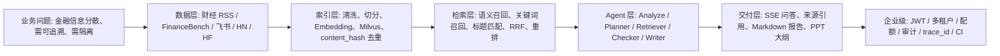

---
tags:
  - interview/rag-finance
  - project/index
  - obsidian/index
aliases:
  - RAG Finance Intelligence 面试知识库
---

# RAG Finance Intelligence 面试知识库

这组笔记用于面试前快速准备 RAG Finance Intelligence 项目。推荐阅读顺序：[[01-详细面试讲稿]] → [[04-项目亮点与难点卡片]] → [[03-高频追问-QA]]，再用 [[02-简历项目描述]] 压成简历表达，最后用 [[05-技术架构速查]] 现场查参数。被追问生产差距时，用 [[07-工程化改进问题库]] 回答。

## 核心文档

- [[01-详细面试讲稿]]：5-10 分钟完整讲项目的主线稿。
- [[02-简历项目描述]]：按后端 / AI / 全栈方向分版的简历表达。
- [[03-高频追问-QA]]：覆盖面试官最可能追问的 16 个技术点。
- [[04-项目亮点与难点卡片]]：6 张可背诵的高价值难点卡片。
- [[05-技术架构速查]]：按模块整理技术栈、链路、关键文件和参数。
- [[06-面试表达模板]]：15 秒 / 30 秒 / 1 分钟 / 3 分钟 / 5 分钟表达版本。
- [[07-工程化改进问题库]]：生产化差距、工程闭环和高压追问回答。

## 项目定位

RAG Finance Intelligence 是一个面向金融场景的双语 RAG 系统，支持财经 RSS、SEC 财报（FinanceBench）、飞书知识库、Hacker News 和 HuggingFace 金融数据集采集，做多路召回 + RRF 融合检索，配合 LangGraph Agent 输出带来源引用的 SSE 流式回答，并通过 JWT、多租户隔离、配额和审计日志满足企业级部署要求。目标是在 4 核 / 15.6GB 服务器上稳定处理 10 万到 100 万篇金融文档。

## 面试主线

## 复习顺序

1. 用 [[01-详细面试讲稿]] 把 5-10 分钟主线讲顺。
2. 用 [[04-项目亮点与难点卡片]] 记住 6 个高价值难点。
3. 用 [[03-高频追问-QA]] 模拟高频追问。
4. 从 [[02-简历项目描述]] 里挑一版放到简历。
5. 用 [[06-面试表达模板]] 准备不同时间窗口的表达。
6. 用 [[05-技术架构速查]] 现场查关键参数和文件路径。
7. 用 [[07-工程化改进问题库]] 准备"离生产还有什么差距"这类追问。

## 关键词

`FastAPI`、`LangGraph`、`Milvus`、`火山引擎 Embedding`、`DeepSeek`、`RRF`、`CrossEncoder Re-ranker`、`SSE`、`JWT`、`多租户`、`company_id`、`Audit Log`、`FinanceBench`、`LLM-as-Judge`、`Feishu / 飞书`、`trace_id`、`structlog`、`pytest`、`GitHub Actions`、`DaisyUI`、`React`、`TypeScript`、`Vite`、`Tailwind`
